#  Screen Time Tracker

[](https://github.com/naimulnashid/screen-time-tracker/actions/workflows/ci.yml)
[](https://github.com/naimulnashid/screen-time-tracker/releases/latest)
[](LICENSE)
[](https://screen-time-tracker-site.vercel.app/)

A local dashboard of how long each app was actually in the foreground, on a
Windows PC and on your Android phones, kept on your own machine and built to
survive a Windows reset.

Windows keeps no usable history of which app had focus, and Android keeps about
ten days of it. This project records both into a SQLite database on a drive a
reset does not touch, and shows them in a Next.js dashboard that runs on your
own PC. **[See it on the project site](https://screen-time-tracker-site.vercel.app/)**:
how it works, every chart it draws (live, on invented data) and every feature.

- **Local only.** The history stays on your PC: no account, no telemetry. The
  one optional outbound connection is the phones' end-to-end encrypted cloud
  inbox; without it nothing leaves your network.
- **Real foreground time**, not process uptime. On Windows a sampler records
  which window has focus and whether the session is locked; on Android the
  phone's own usage events are rebuilt into sessions and screen-on time.
- **A personal tool, shared as is.** It is built and used on one PC and a few
  phones. Read the scripts before trusting them with your data.

## Screenshots

> **Every number in these images is invented.** They come from `npm run
> demo:seed`, a synthetic laptop and phone, captured by `npm run demo:shots`
> (see [Development](#development)). App logos are not shipped: the script
> borrows the ones you have added, for the demo's own apps only, and a fresh
> clone shows each app's initial until you add some. Each image follows your
> GitHub theme.

The laptop's Overview: the latest day, the daily average and all history, the
daily trend, a six-month heat map, the top apps and the most opened apps day by
day with their own range menus, the shape of the day, and where every minute
went.

<picture>
  <source media="(prefers-color-scheme: light)" srcset="docs/screenshots/tour/laptop-1-overview-light.png">
  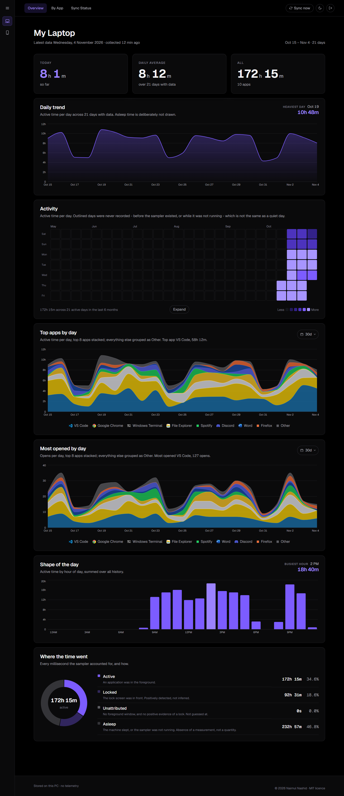
</picture>

<details>
<summary><b>By App as a table and a grid, one app in detail, the other laptop pages, and a phone</b></summary>

Every app, ranked by time and by opens in its brand colour, then listed.

<picture>
  <source media="(prefers-color-scheme: light)" srcset="docs/screenshots/tour/laptop-2-by-app-light.png">
  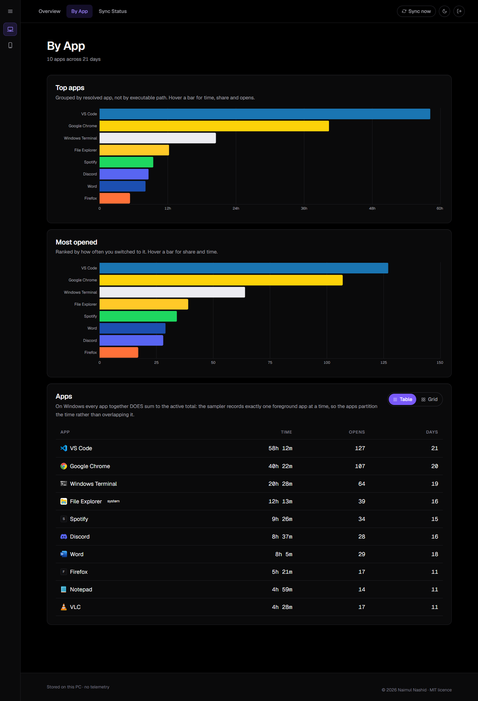
</picture>

The same list as a grid of cards.

<picture>
  <source media="(prefers-color-scheme: light)" srcset="docs/screenshots/tour/laptop-2-by-app-grid-light.png">
  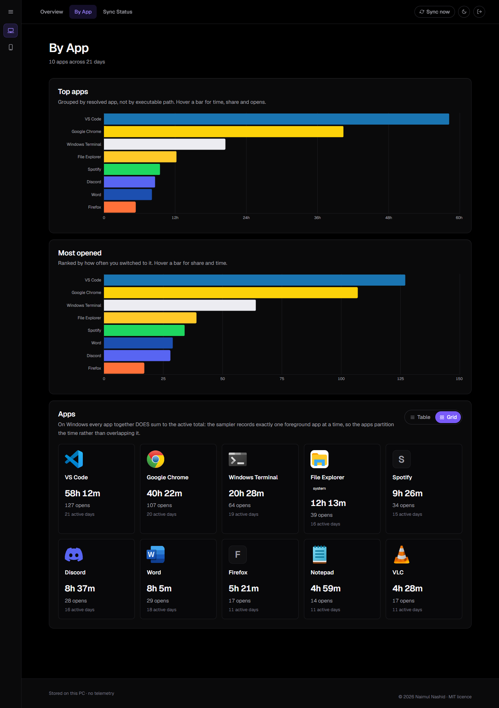
</picture>

One app: its total, opens, typical and longest session, time and opens per day
under one range menu, per hour, and the paths it was resolved from.

<picture>
  <source media="(prefers-color-scheme: light)" srcset="docs/screenshots/tour/laptop-3-app-detail-light.png">
  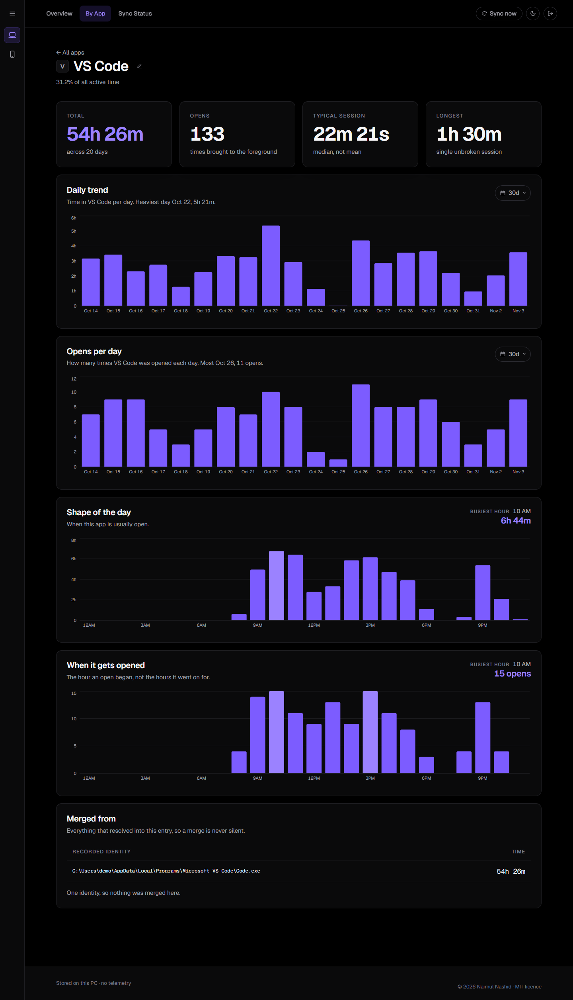
</picture>

The heat map expanded to every recorded day, and Sync Status.

<picture>
  <source media="(prefers-color-scheme: light)" srcset="docs/screenshots/tour/laptop-4-activity-light.png">
  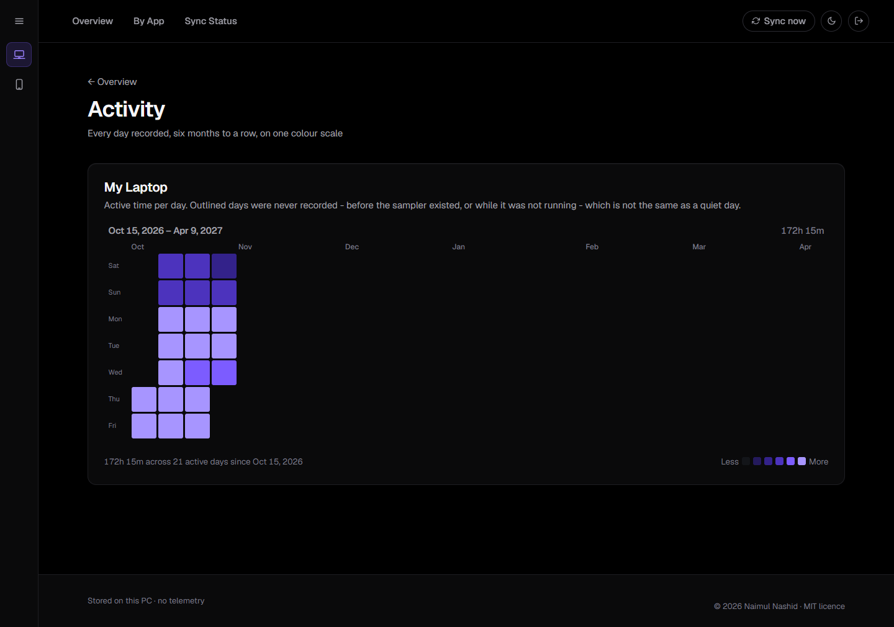
</picture>

<picture>
  <source media="(prefers-color-scheme: light)" srcset="docs/screenshots/tour/laptop-5-sync-light.png">
  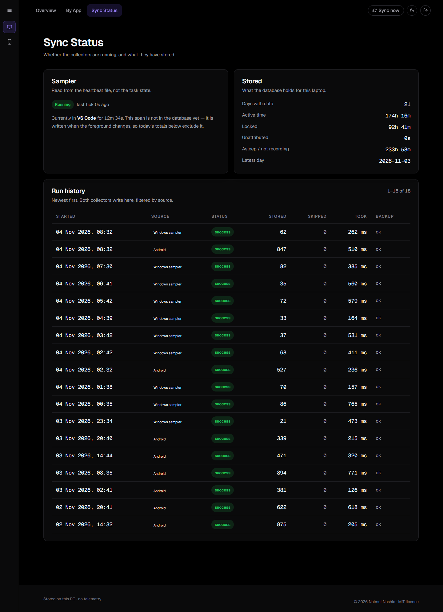
</picture>

A phone, in its own accent: screen-on time and unlocks, and how much of it any
app accounts for.

<picture>
  <source media="(prefers-color-scheme: light)" srcset="docs/screenshots/tour/phone-1-overview-light.png">
  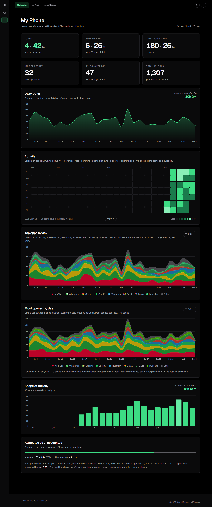
</picture>

<picture>
  <source media="(prefers-color-scheme: light)" srcset="docs/screenshots/tour/phone-2-by-app-light.png">
  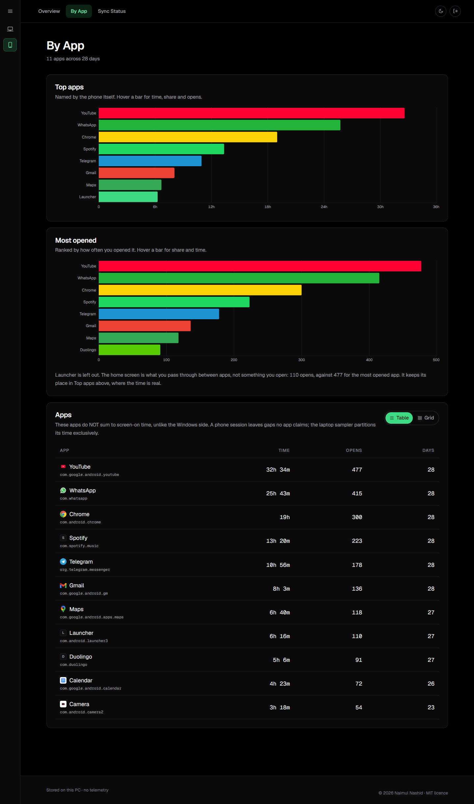
</picture>

<picture>
  <source media="(prefers-color-scheme: light)" srcset="docs/screenshots/tour/phone-3-app-detail-light.png">
  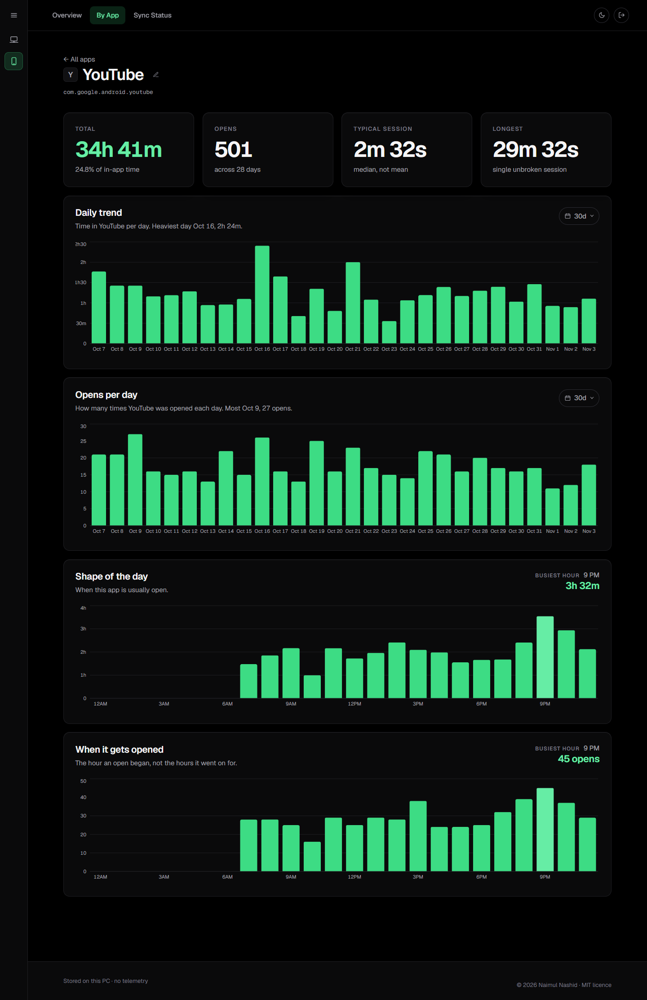
</picture>

<picture>
  <source media="(prefers-color-scheme: light)" srcset="docs/screenshots/tour/phone-4-activity-light.png">
  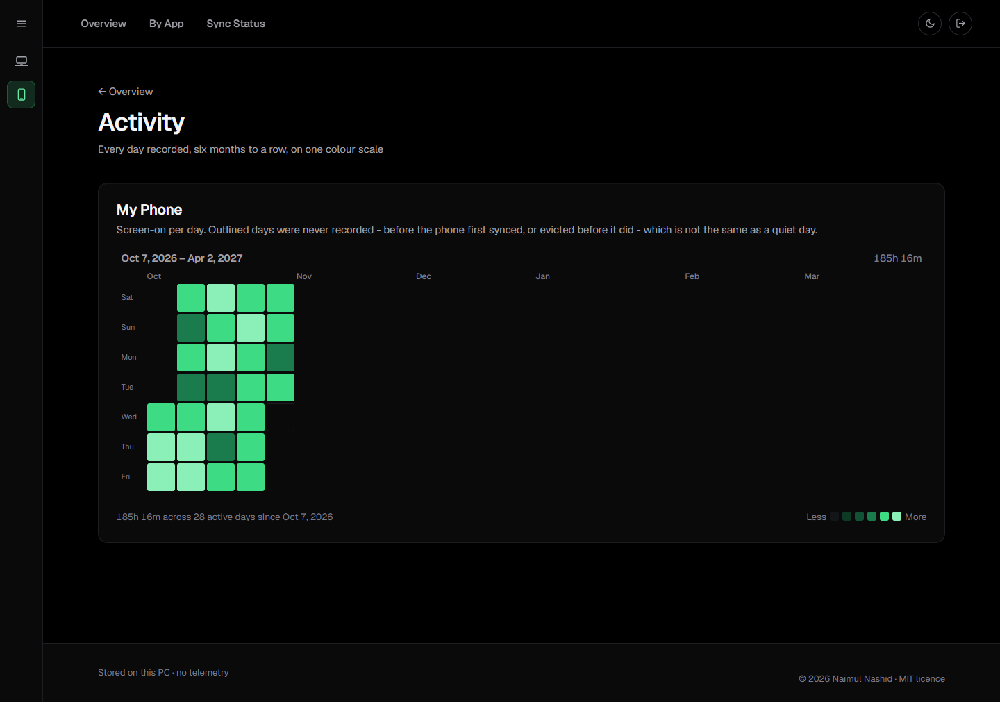
</picture>

<picture>
  <source media="(prefers-color-scheme: light)" srcset="docs/screenshots/tour/phone-5-sync-light.png">
  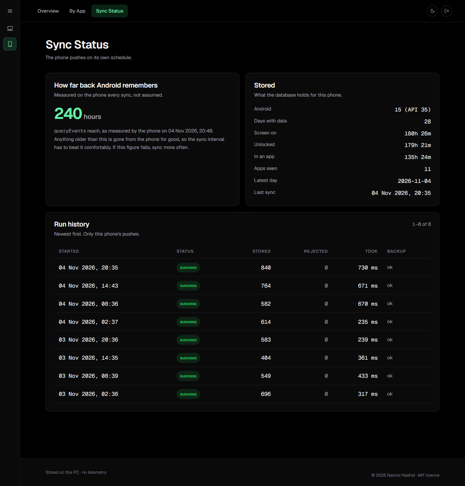
</picture>

</details>

## Features

- **Foreground time on Windows**, sampled every 2 seconds without elevation,
  with lock state from Windows' own session API, and appended to SQLite on
  another drive by an hourly task and a **Sync now** button. A consistent
  single-file backup is written after every ingest. It can also read the
  standalone [Screen Time Native](https://github.com/naimulnashid/screen-time-native)
  app's database instead of running its own sampler.
- **Screen time on Android phones (optional)**: a dependency-free reporter app
  rebuilds sessions, screen-on time and unlocks from Android's usage events and
  sends them every few hours, straight to the dashboard or through an
  end-to-end encrypted cloud inbox. A phone below Android 9, which records no
  screen events, gets time in apps instead.
- **Overview**: the latest day, the daily average and all history; the daily
  trend with every day well above trend marked; a six-month heat map,
  expandable to every recorded day; the top apps and the most opened apps day
  by day, each with its own 7d / 30d / 90d / All menu; the shape of the day;
  and where the time went (laptop) or how much of screen-on any app accounts
  for (phone).
- **By App**: the top apps by time and by opens, and every app as a table or a
  grid of cards. **Hide** an app from the list (every total still counts it),
  or **merge** one app into another and separate it again.
- **App detail**: total, opens, typical and longest session, time and opens
  per day under one range menu, per hour, and what was merged into it.
- **Opens are visits**, not raw sessions: switching away and straight back, or
  moving between screens of one app, counts once.
- **Rename any app and choose its colour**, stored with the history.
- **Sync Status**: whether the sampler is running, the run history, and on a
  phone how far back Android's history reaches. The phone app warns before
  unsent history is lost.
- **Light and dark themes**, an installable web app, Backspace to go back from
  a detail page, and screen-reader summaries for every chart.
- **Reset recovery** you can rehearse without resetting: `npm run drill`.

## Installation and getting started

### Requirements

- **Windows 10 or 11** for the dashboard and the PC collector.
- **Node.js 22.16 or newer** (`engines` in `package.json`). The project uses
  Node's built-in `node:sqlite`, so there are no native modules to compile.
- **A drive that is not the system drive**, such as `D:\`, for the database.
  The code refuses to put it on `C:\`, since surviving a reset is the point.
- **Optional, for phones:** Android 8.1 or newer (`minSdk` 27). Below Android
  9 a phone records no screen-on or unlock events, so its pages show time in
  apps instead of screen time. Building the APK yourself needs JDK 17 or
  Android Studio.

There is no installer for the dashboard: it is cloned and built. The phone
app's signed APK is attached to each
[release](https://github.com/naimulnashid/screen-time-tracker/releases/latest).

### 1. Install and build the dashboard

From the repository root, in any shell:

```bash
git clone https://github.com/naimulnashid/screen-time-tracker.git
```

```bash
cd screen-time-tracker
```

```bash
npm ci
```

Then set up [Configuration](#configuration), and build it and register it to
start at every logon:

```bash
npm run build
```

```bash
npm run autostart -- -RunNow
```

It serves on `http://localhost:7844`. The logon task rebuilds whenever the
source is newer than the build, and a running dashboard restarts itself once a
new `npm run build` finishes. `start-screen-time-dashboard.bat` and
`stop-dashboard.bat` do the same by hand.

### 2. Start recording on Windows

```bash
powershell -ExecutionPolicy Bypass -File scripts\install-sampler.ps1 -RunNow
```

This registers two unelevated tasks: the sampler, at logon, and the ingest,
hourly. Windows keeps no usable history of foreground time, so recording
starts from the moment the sampler runs.

**Or let Screen Time Native record.** If the PC runs
[Screen Time Native](https://github.com/naimulnashid/screen-time-native), run
only one sampler, or every second is recorded twice. Register just the ingest
with `install-sampler.ps1 -IngestOnly` (it stops a running sampler cleanly),
run `npm run ingest` once more, then set `nativeDatabasePath` and `nativeFrom`
in `config/collector.json`.

### 3. Add an Android phone (optional)

1. Download the signed APK from the
   [latest release](https://github.com/naimulnashid/screen-time-tracker/releases/latest)
   and install it; Android asks you to allow installs from your browser or
   file manager. It is not on the Play Store. To build it yourself, see
   [Building the phone app](#building-the-phone-app).
2. In the app, tap **Grant** beside *Usage access* and enable *Screen Time
   Reporter*.
3. Enter the dashboard's address (`http://<your PC's LAN IP>:7844`) and your
   `ANDROID_INGEST_TOKEN`, then tap **Save and test connection**.

The phone syncs in the background. Android keeps about 10 days of event
history, so the first sync backfills that much. If the dashboard has not
received the phone's history for 168 hours (sooner on a phone that keeps less),
the app posts a notification before the oldest of it is lost; allow
notifications when it asks.

### 4. Back it up

```bash
npm run backup:kit
```

```bash
npm run drill
```

The first copies the secrets and any local-only files off `C:\`, and the code
while it is not pushed; the second restores the backup into a temporary folder,
checks it and lists anything a reset would lose. Re-run `backup:kit` after
changing config, logos or secrets: the drill fails when its copy is out of
date.

## Configuration

Two files, both outside version control.

**`config/collector.json`**: copy
[`config/collector.example.json`](config/collector.example.json), which
explains every key, and edit the paths.

| Key | What it is |
|---|---|
| `databasePath` | The working database. **Not on `C:\`.** |
| `backupPath` | The consistent backup written after every ingest. Restore from this one. |
| `scratchDir` | Working space. Keep it outside any cloud-synced folder. |
| `secretsDir` | Optional. Where the recovery kit copies the secrets; defaults to `<scratchDir>\recovery`. Off `C:\`, and not synced. |
| `samplerLogDir` | Where the sampler appends its spans between ingests. Off `C:\`. |
| `deviceLabel` | What the dashboard calls this PC; also its URL (`/windows/<slug>`). |
| `nativeDatabasePath`, `nativeFrom`, `nativeSamplerDir` | Optional. Read Screen Time Native's database from `nativeFrom`, a local hour edge, on. |
| `inbox` | Optional. The cloud inbox's `url` and `keyPath`; see below. |
| `backupEnabled` | `true` to write the backup after every ingest. |

**`.env.local`**: copy [`.env.example`](.env.example) and fill it in. A long
random value for each, for example:

```bash
node -e "console.log(require('crypto').randomBytes(24).toString('base64url'))"
```

| Variable | What it is |
|---|---|
| `DASHBOARD_PASSWORD` | Required. The dashboard **fails closed**: with none set, it refuses every request. Changing it signs out every device. |
| `ANDROID_INGEST_TOKEN` | For phones: the token the app sends. Separate from the password, so the password never lives on a phone. Fails closed too. |
| `INBOX_DRAIN_TOKEN` | For the cloud inbox only: the PC's own token, added by `npm run inbox -- drain-token`. |

### Optional: a cloud inbox, so a phone can report from anywhere

On its own the phone posts straight to the dashboard, so it must be on the
PC's network, the PC must be on, and the address changes whenever the router
hands the PC a new one. A **cloud inbox** removes all three: the phone posts to
a fixed `https://` address on any network, and the PC collects whatever is
waiting at its hourly ingest and on **Sync now**.

**The inbox cannot read what it holds.** The app encrypts each upload to a key
only the PC has (P-256 ECDH, AES-256-GCM), with your ingest token mixed into
the key derivation, so the inbox cannot forge one either. It sees an upload's
size, its time and the phone's random device id. The format is written out at
the top of `src/lib/inbox.ts`. It runs on Supabase's free tier as one Edge
Function and two tables, in `supabase/`.

1. Create a Supabase project. Run `supabase/migrations/*.sql` in order in its
   SQL editor, and deploy the function with JWT verification off (it checks
   its own tokens):

   ```bash
   supabase functions deploy inbox --no-verify-jwt
   ```

2. In `config/collector.json`, set
   `"inbox": { "url": "https://<project>.supabase.co/functions/v1/inbox/screen-time", "keyPath": "D:\\keys\\inbox-key.pem" }`.
   Keep the key off `C:\` and out of the repo, and back it up: anything still
   in the inbox cannot be opened without it.
3. Create the key and the PC's own token, then print the SQL that registers
   both tokens, and run it in the SQL editor (it holds SHA-256 digests only):

   ```bash
   npm run inbox -- keygen
   ```

   ```bash
   npm run inbox -- drain-token
   ```

   ```bash
   npm run inbox -- sql
   ```

4. Rebuild and restart the dashboard. On the phone, at home, tap **Set up from
   the dashboard**: the app fetches the inbox address and the PC's key over the
   LAN, never from the inbox, and shows the key's fingerprint, which `npm run
   inbox -- key` prints too.

An upload that cannot be opened stays in the inbox, marked failed; fix the
cause, then run `npm run inbox -- drain --retry-failed`, or tap **Full resync**
on the phone.

### App logos (optional)

No logos ship with the repository: they are other companies' trademarks. Drop
your own into `public/apps_logo/`, and brand colours into
`config/app-colours.json`; both are gitignored. Until then every app shows its
initial. See [`public/apps_logo/README.md`](public/apps_logo/README.md).

## Usage

Open `http://localhost:7844` and sign in with `DASHBOARD_PASSWORD`. The sidebar
lists the PC and every phone that has reported; each has the same pages.

| Page | Shows |
|---|---|
| **Overview** | Latest day, daily average and all history; the trend; the heat map; top and most opened apps by day; the shape of the day; where the time went |
| **By App** | Top apps by time and by opens, then every app as a table or a grid; click a name, a bar or a card to open the app |
| **App detail** | One app's totals, sessions, per-day and per-hour time and opens, and what was merged into it |
| **Activity** | The heat map, expanded to every recorded day (from the Overview's Expand) |
| **Sync Status** | Whether collection is running, what is stored, and every run |

**Every page covers all history.** The by-day charts each have a 7d / 30d /
90d / All menu at their top right, opening on 30d. **Sync now** in the top bar
folds in what the sampler has recorded since the last ingest, and empties the
cloud inbox when there is one.

**Your own names, colours and groupings.** On By App, the "..." beside an
app's name opens **Rename or recolour…**, hides the app from By App, or merges
it into another app; on an app's own page the pencil beside its name renames
it. A merged app is then counted as part of that app everywhere, and the app's
Merged apps card separates it again. All of these are stored in the database
with the history.

**Light or dark.** The menu in the top bar switches between a dark theme, a
light theme, or following your system, remembered per browser, as is By App's
table or grid.

**The phone's apps add up to less than its screen-on time, on purpose.** The
lock screen, the launcher and system surfaces hold time no app claims, so the
headline comes from screen-on events, and the last card on a phone's Overview
shows the gap. On Windows the apps do add up to the active total.

**Watch Sync Status.** Recording only happens while the sampler runs; nothing
can be filled in afterwards.

### Install as an app

In Edge or Chrome on the PC, open `http://localhost:7844` and use the install
icon in the address bar. It opens in its own window with the clock icon.
Installing needs `localhost` or HTTPS, so a phone reaching the dashboard over
the LAN can only add a shortcut that opens in the browser.

### Everyday commands

| | |
|---|---|
| Fold in the sampler's spans now | `npm run ingest` (the hourly task does this) |
| Stop the dashboard | `npm run dashboard:stop`, or double-click `stop-dashboard.bat` |
| Turn off autostart | `npm run autostart -- -Remove` |
| Fold an old phone entry into a new one after a reinstall | `npm run android:merge -- --from <old-slug> --into <new-slug>` (reports first; writes only with `--apply`) |
| Logs | `logs\dashboard.log`, `logs\ingest.log` |

### Recovery after a Windows reset

A reset erases `C:\`: the repo, Node and the scheduled tasks. The database
drive survives. Rehearse the recovery any time with `npm run drill`.

1. Install [Node.js](https://nodejs.org) and [Git](https://git-scm.com), clone
   this repo and run `npm ci`.
2. Copy `config/collector.json` back from the `local-files` folder beside your
   backup, and `.env.local` from your secrets folder. `RESTORE.txt` beside the
   backup lists both. **Keep `ANDROID_INGEST_TOKEN` as it was**, or the phones
   stop syncing without saying so here.
3. Restore the database from the backup (stop the dashboard first):

   ```bash
   npm run restore
   ```

   It copies the backup over the working database, never the reverse. The
   database it replaces is kept beside it as one complete copy, and it refuses
   to overwrite a database holding more rows than the backup without `-Force`.
4. Re-register the tasks with `install-sampler.ps1 -RunNow` and `npm run
   autostart -- -RunNow`.

## Tech stack and architecture

- **Windows collector**: a PowerShell sampler run by Task Scheduler, polling
  `GetForegroundWindow` and `WTSQuerySessionInformation`, writing daily JSONL;
  a TypeScript ingest (`scripts/ingest-windows.ts`, run with `tsx`).
- **Database**: SQLite through Node's built-in `node:sqlite`, in WAL mode, with
  a `backup()` copy for restores.
- **Dashboard**: Next.js 16 (App Router), React 19, TypeScript, Recharts and
  the Geist typeface; one password gate in `src/proxy.ts`, Web Crypto sessions.
- **Phone app**: Kotlin on Android's public `UsageStatsManager`, with no
  dependencies; JobScheduler, `HttpURLConnection` and views built in code.
- **Cloud inbox (optional)**: one Supabase Edge Function and two tables.

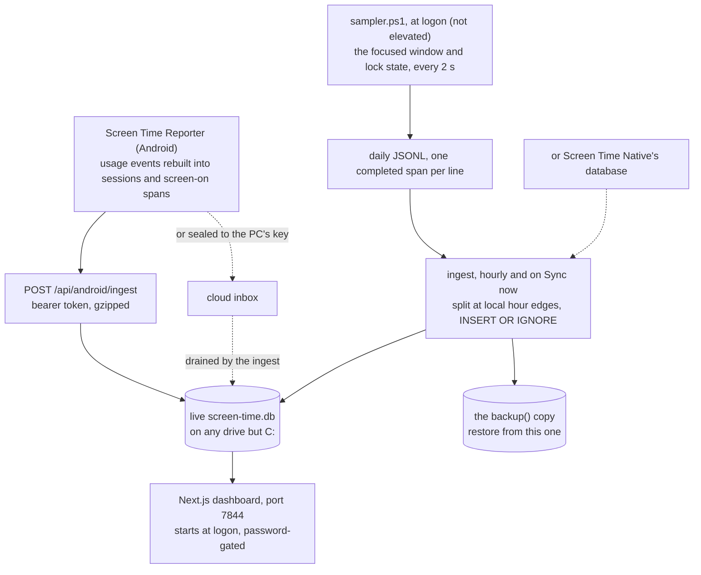

The two halves measure differently, so the headline is computed differently
for each: on Windows the sampler's spans partition the day, so the apps sum to
the total; on a phone the apps cover only about three quarters of screen-on
time, so the headline comes from screen-on events. The measurements behind
every design decision, and the traps found by running things, are in
[`docs/DEVLOG.md`](docs/DEVLOG.md).

## Security and privacy

- **Where data lives:** one SQLite database and its backup, on the drive you
  set in `config/collector.json`. Neither is encrypted at rest, so keep that
  folder where only your account can read it. The browser stores only your
  theme, sidebar and list view, never usage data.
- **What is recorded:** which app had focus and for how long, and on a phone
  sessions, screen-on spans and unlocks. **Window titles are never captured**:
  a title can name the document, page or person on screen.
- **Credentials:** the password and tokens live in `.env.local`, in plain
  text, gitignored. The session cookie is signed with a key derived from the
  password by PBKDF2, so changing the password signs every device out. There
  are no default credentials, and a missing password locks the dashboard.
- **What it exposes:** the dashboard listens on every network interface,
  because the phones post to it over the LAN. Every page and API route is
  behind the password, wrong guesses are throttled, and state-changing
  requests must come from the dashboard's own origin. Run `npm run firewall`
  once, from an Administrator shell, to block it on Public networks (mark your
  home network Private first, or the phone is cut off).
- **The phone** stores the dashboard address, its token and its settings in its
  private app storage. It sends app sessions, package names and labels, and its
  model and Android version.
- **What leaves the PC:** nothing, unless you set up the cloud inbox, which
  carries only the phones' uploads, encrypted on the phone to a key the inbox
  never sees.
- **Known limitations:** on the LAN it is plain HTTP, so the password and the
  session cross the network unencrypted; and a screen that turns off while the
  PC stays unlocked still counts as foreground time.

[`SECURITY.md`](SECURITY.md) has the threat model and how to report a
vulnerability.

## Accessibility

The pages are built to WCAG 2.1 AA: contrast is measured, every page has its
own title, every chart has a text summary, and there is a skip link. Two
deliberate exceptions: phones get the desktop layout zoomed to fit rather than
a narrow reflow (pinch-zoom still works), and the heat map's quietest shades
sit close to the background (every cell has a title).

## Development

All commands run from the repository root; `npm` ones in any shell, the
PowerShell ones in Windows PowerShell or PowerShell 7.

| | |
|---|---|
| Install dependencies | `npm ci` |
| Typecheck | `npm run typecheck` |
| Self-test, no device or database needed | `npm run selftest` |
| The cloud inbox function, against an in-memory database | `npm run test:inbox-function` |
| The phone app's unit tests, from `android/` (Android Studio's JDK as `JAVA_HOME`) | `./gradlew testDebugUnitTest` |
| Then open the envelopes those tests sealed, with the laptop's code | `npx tsx scripts/open-kotlin-envelopes.ts` |
| Production build | `npm run build` |
| Development server on port 7844 (stop the logon-task server first: they share `.next`) | `npm run dev` |
| The reset drill, against your real backup | `npm run drill` |

CI runs all of these but the drill, plus a production build, a PowerShell
5.1 check, the APK build and a Deno type-check of the inbox function, on
every push.

### Trying it without your own data

```bash
npm run demo:seed
```

```bash
npm run demo
```

The first writes a synthetic laptop and phone into `demo/` (gitignored); the
second serves them on `http://localhost:7849` from the current build, signed in
with the `DASHBOARD_PASSWORD` in your `.env.local`. `npm run demo:shots` retakes
every screenshot above: it builds a scratch copy beside the repo, seeds the
demo, serves it with a throwaway password and captures every page in headless
Edge, dark then light, in one run.

### Building the phone app

From `android\`, with a JDK as `JAVA_HOME` (Android Studio's bundled one
works):

```bash
cd android && ./gradlew assembleDebug
```

Install `app/build/outputs/apk/debug/app-debug.apk`, for example with `adb
install`. A self-built copy is signed with a different key, so it cannot
install over the released one without uninstalling first, and uninstalling
resets the phone's device id (fold the old entry back with `npm run
android:merge`). To sign your own release builds, point
`android/keystore.properties` (gitignored) at your keystore with `storeFile`,
`storePassword`, `keyAlias` and `keyPassword`, then run `./gradlew
assembleRelease lintRelease`.

**Before changing anything, read [`docs/DEVLOG.md`](docs/DEVLOG.md)**, the
day-by-day design record. `scripts/research/` holds the measurements that
shaped the design; nothing there is needed to run the tracker.

## Contributing, license and support

Issues are welcome; see [`CONTRIBUTING.md`](CONTRIBUTING.md). For a pull
request, please open an issue first, since the design is deliberately narrow,
and never include your own usage data or device names.

Released under the [MIT](LICENSE) license, © 2026 Naimul Nashid. App names and
logos belong to their owners; none are distributed here.

Questions and bug reports go to the
[issue tracker](https://github.com/naimulnashid/screen-time-tracker/issues).
